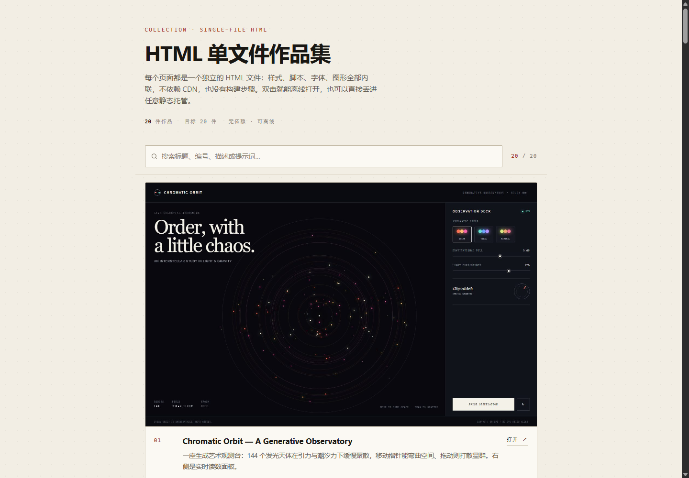

# HTML 单文件作品集

20 个自包含的网页作品。每一件都是一个 HTML 文件：样式、脚本、SVG 全部内联，没有外部字体、图片、CDN 或构建步骤，双击就能离线打开。



## 内容

作品本身是英文的编辑式单页——生成艺术观测台、深夜蓝调电台、植物标本档案、夜间赛道、纸片电影、云上茶室、深空接收站等。画廊是中文的：**搜索**、**编号**、**截图预览**、可展开的**原始提示词**。

- 20 个作品页，命名从 01 到 20
- 同名 txt 保存元数据：标题、描述、提示词、技术要点
- index.html 是自动生成的画廊，不要手改
- studies.json 是同一份元数据的机器可读版本，方便二次利用

## 目录结构

```text
.
├── index.html                 # 自动生成的画廊
├── 01-chromatic-orbit.html    # 作品
├── 01-chromatic-orbit.txt     # 作品元数据
├── thumbs/                    # 1440×900 预览图
├── studies.json               # 元数据汇总
└── scripts/
    ├── build_gallery.py       # 重建 index.html 和 studies.json
    ├── capture_screenshots.py # 重拍预览图
    └── new_study.py           # 新建下一件作品的骨架
```

## 本地预览

直接双击 index.html，搜索和提示词面板都是纯前端逻辑，不需要服务器。

要在手机上看，起一个静态服务器，然后访问电脑的局域网 IP：

```bash
python -m http.server 8000
```

## 新增一件作品

```bash
python scripts/new_study.py "潮汐线" --slug tide-lines
```

脚本会占用下一个序号，位数跟现有文件一致，生成 **21-tide-lines.html** 和同名 txt。写完页面后：

```bash
python scripts/capture_screenshots.py 21    # 只拍这一张
python scripts/build_gallery.py             # 重建画廊
```

序号两位三位都认，按数字大小排序。作品文件必须是**单文件**：不引用外部 CSS/JS、不加载网络字体、图片用内联 SVG 或 data URI。这是整组作品的共同约束，也是它们能直接离线打开的原因。

## 重新拍预览图

```bash
python scripts/capture_screenshots.py
```

脚本优先用 Playwright 打开页面、等 1.8 秒让动画进入状态，再截 1440×900。没装 Playwright 时自动退到本机 Chrome 的无头模式，装了 Pillow 会把 PNG 压成 JPEG——20 张一共 1.7MB 左右。

## 发布到 GitHub Pages

仓库建好之后只需要三步。下面的仓库名 **html-studies** 可以换成你想要的：

```bash
gh repo create html-studies --public --source=. --remote=origin --push
gh api --method POST repos/ennheng/html-studies/pages \
  -f 'source[branch]=main' -f 'source[path]=/'
```

等一两分钟，地址是 **https://ennheng.github.io/html-studies/**。

不想用命令行，就在网页上操作：先 push 到 GitHub，然后 **Settings → Pages → Deploy from a branch**，分支选 main、目录选 **/(root)**。仓库里的 .nojekyll 会阻止 Jekyll 处理文件，favicon 和中文文件名都不会出问题。

## 自动部署（可选）

把 .github/workflows/pages.yml.example 改名为 **pages.yml**，再把 Pages 的 Source 从分支切成 **GitHub Actions**。之后每次 push，CI 会重建画廊、重拍全部截图、再部署，本地不用提交 thumbs。

代价是每次部署多花两三分钟装 Playwright，20 件作品不值得，作品多了再开。

## 补齐提示词

现在 20 个 txt 里 **PROMPT** 段是空的，所以卡片上只有「打开 ↗」。

把生成每一页时用的完整提示词粘进对应 txt 的 PROMPT 段，重新跑 build_gallery.py，卡片上就会多出「提示词」按钮和展开面板——那才是这类作品集真正值钱的部分：**别人能看见同样的输入换来了什么输出**。

## 分享到 X / 社交平台

index.html 已经带 og 和 Twitter Card 元标签，og.jpg 是 1200×630 的分享卡。把链接贴进推文，就会展开成一张大图卡片。

如果你想发成 Mia 那种「四张截图 + 链接」的串，具体文案、配图顺序和坑都写在 **X发布文案.md** 里。

改过 SITE_URL 或 og.jpg 之后，记得同步改 build_gallery.py 顶部的常量，再重新 build。

## 部署到别处

纯静态，整个文件夹可以直接拖进 Cloudflare Pages、Vercel、Netlify，不需要任何构建配置。也可以放到你自己的域名下，当作作品集的一个子目录。
